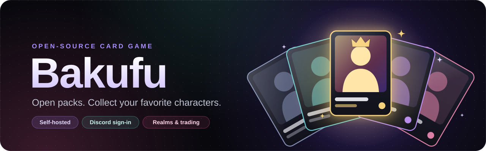

<p align="center">
  
</p>

# Bakufu

An open-source collectible character card game for Discord communities. Each
community gets its own **realm**: players sign in with Discord, open packs of
anime and manga characters, and build collections in which every character has
exactly one owner. Bakufu is self-hosted, so your community owns its data.

> **Status: alpha** (`0.1.0-alpha.1`). Playable and tested, still changing. See
> the [changelog](CHANGELOG.md).

## Features

- **Realms** with their own economy, rules and roster; a character can belong to
  only one player per realm, and different realms never mix.
- **Rosters** from MyAnimeList or AniList (opt-in, paced, with artwork only by
  permission): anime, manga, manhwa, manhua, donghua, films and light novels, up
  to 100 characters per series; or your own JSON/CSV catalog. Grow or trim a
  roster after creation. Rarity comes from popularity,
  standing within each series and main-cast role, with fame floors so
  well-known characters are never stuck low.
- **Packs** generated from the roster (demographics, genres, eras, Waifus and
  Husbandos) with 1/5/10 openings, tiered reveal animations and sounds, and a
  live feed of big pulls.
- **Collection**, character glossary, wishlists, recycling (one card, several at
  once, or straight from the opening results; epic and legendary cards can be
  protected), timed gem claims, collector ranks fitted to the realm's rules,
  trading between players and a gem market.
- **Player profiles** with a showcase, page colour and optional wishlist, a
  players directory with a leaderboard, and "Propose a trade" from any profile.
- **Discord sign-in** as the main login, plus optional `/bakufu` slash commands.
- **Administration**: game rules with reviewed previews, packs, characters,
  rarity (fame floors and manual tiers), reveal sounds per rarity or character,
  joining and invites, and repair tools for player collections.
- **Your data stays yours**: encrypted backups with automatic restore checks,
  and player exports.

## Quick start (Docker on your PC)

1. Install Docker Desktop and clone this repository (or download it as a ZIP).
2. Copy `.env.example` to `.env` and replace the example database password (it
   appears twice) with one long random value.
3. Set up Discord sign-in: create an application in the Discord Developer
   Portal, add the redirect `http://localhost:3000/api/auth/discord/callback`,
   and fill in `DISCORD_CLIENT_ID`, `DISCORD_CLIENT_SECRET` and your own Discord
   user ID as `DISCORD_ADMIN_USER_ID` ([guide](docs/deployment/discord-login.md)).
4. Start it:

   ```sh
   docker compose up -d
   ```

   This downloads the ready-made Bakufu image (Intel/AMD and ARM, such as a
   Raspberry Pi); nothing is compiled on your machine. To build from the source
   instead, use `docker compose up --build -d`.

5. Open <http://localhost:3000>, sign in with Discord (you become the admin),
   then go to **Administration → New realm**.

Without Discord, create a local admin with `docker compose exec web pnpm bootstrap`
and players with `docker compose exec web pnpm player:create`. More detail:
[self-hosting guide](docs/deployment/quickstart.md).

## Hosting

| Option | Cost | Guide |
| --- | --- | --- |
| Free: Vercel + Neon (Discord sign-in, no slash commands, rosters up to about 5,000 characters) | Free tiers | [vercel-neon.md](docs/deployment/vercel-neon.md) |
| Your own server with Docker and HTTPS | A small VPS | [https.md](docs/deployment/https.md) |

> **Free tiers have monthly limits.** Neon Free allows 5 GB of database
> transfer a month; when it runs out the database pauses until the next month.
> Up to about 5,000 characters per realm should be fine there; check the usage
> in the first weeks: [how big can a realm get?](docs/deployment/vercel-neon.md#how-big-can-a-realm-get)
> Self-hosting with Docker has no such limit.

Back up before every update: [backups](docs/deployment/backups.md),
[scheduled backups](docs/deployment/scheduled-backups.md),
[offsite copies](docs/deployment/offsite-backups.md).

## Documentation

- **Setup:** [self-hosting with Docker](docs/deployment/quickstart.md),
  [Discord sign-in](docs/deployment/discord-login.md),
  [Discord commands](docs/deployment/discord-gameplay.md),
  [account settings](docs/deployment/account-settings.md),
  [restore checks](docs/deployment/restore-checks.md),
  [backup alerts](docs/deployment/backup-alerts.md)
- **Gameplay:** [rarity and economy](docs/gameplay/rarity-economy.md),
  [character values](docs/gameplay/character-values.md),
  [pack reveals](docs/gameplay/pack-reveals.md),
  [pack bundles](docs/gameplay/pack-bundles.md),
  [discovery](docs/gameplay/discovery.md),
  [recycling](docs/gameplay/recycling.md),
  [trading](docs/gameplay/trading.md),
  [market](docs/gameplay/market.md),
  [wishlist](docs/gameplay/wishlist.md),
  [gem claims](docs/gameplay/gem-claims.md),
  [collector ranks](docs/gameplay/collector-ranks.md),
  [progression](docs/gameplay/progression.md),
  [upgrades](docs/gameplay/upgrades.md),
  [members](docs/gameplay/members.md),
  [player profiles](docs/gameplay/profiles.md),
  [joining a realm](docs/gameplay/admission.md),
  [game rules](docs/gameplay/settings.md),
  [player collections](docs/gameplay/admin-collections.md)
- **Content:** [providers](docs/content/providers.md),
  [catalog format](docs/content/catalog.md),
  [starter packs](docs/content/starter-packs.md),
  [demo art](docs/content/demo-art.md)
- **Project:** [implementation status](docs/implementation-status.md),
  [product specification](docs/specification.md),
  [architecture decision](docs/architecture/0001-realm-transactions.md),
  [interface design](docs/design/interface.md),
  [privacy](docs/privacy.md)

## Development

Needs Node 22.13+, pnpm 10.34.0 and PostgreSQL 18 (or Docker for the database).

```sh
pnpm install --frozen-lockfile
docker compose -f compose.yaml -f infra/docker/compose.dev.yaml up -d db
pnpm db:migrate
pnpm dev
```

Checks (CI runs the first five on every push):

```sh
pnpm lint
pnpm typecheck
pnpm test              # unit tests
pnpm test:integration  # real, disposable PostgreSQL
pnpm build
pnpm test:e2e          # production build in a real browser
```

No test touches your live database or calls external character APIs.

```text
apps/web/           Next.js website and HTTP API
apps/worker/        Optional backup scheduler and restore checks
packages/core/      Game rules: packs, odds, economy, trading
packages/config/    Versioned realm settings
packages/importers/ Catalog formats and provider adapters
packages/db/        PostgreSQL schema, transactions, backups, exports
scripts/            Operator commands and the browser test suite
tests/              Unit and integration tests
infra/docker/       Production image, HTTPS and backup recipes
docs/               Guides, rules, architecture and reports
```

Contributions are welcome: see [CONTRIBUTING.md](CONTRIBUTING.md) (coding agents:
[AGENTS.md](AGENTS.md)). Report security problems privately as described in
[SECURITY.md](SECURITY.md).

## Content and rights

Bakufu ships only original demo characters and art. Provider rosters are opt-in,
paced and stored as metadata; character artwork is shown only when an admin
confirms permission, and is loaded from the provider, never copied. Nothing in
this repository grants rights to third-party characters, artwork or names.

## License

The original code and demo content are [MIT licensed](LICENSE). That license
does not extend to imported metadata, artwork or other third-party content.
